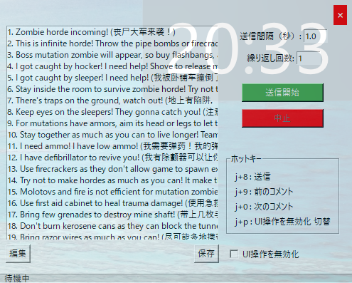
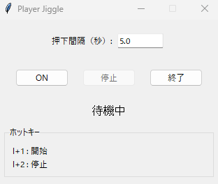

# b4b-apps

Windows 向けの小さな Python ツールをまとめたリポジトリです。

## 含まれるアプリ

- `comment-sender`: Back 4 Blood用の定型コメントを素早く送信する GUI ツール
- `player-jiggle`: Back 4 Blood用の`W / A / S / D`をランダムに入力する簡易ツール

## 各アプリの使い方

詳細はそれぞれの README を参照してください。

- [comment-sender/README.md](comment-sender/README.md)
- [player-jiggle/README.md](player-jiggle/README.md)

## 機能

### Comment Sender v1.1.0
- 多言語対応（英語、中国語、日本語、韓国語）
- ホットキー対応（j+8/9/0/p）
- 設定の永続化（~/.mini-tools/comment-sender/settings.json）
- UI操作の無効化モード

### Player Jiggle v1.1.0
- キー操作シミュレーション
- ホットキー対応（l+1/2）
- 設定の永続化（~/.mini-tools/player-jiggle/settings.json）
- ランダムな方向キー入力

## コード品質

この内容は [findings.md](findings.md#readme-1) にまとめています。

## CI / Release

この内容は [findings.md](findings.md#readme-2) にまとめています。

## 開発

この内容は [findings.md](findings.md#readme-3) にまとめています。

## ライセンス

MIT License

## 依存更新の自動処理

この内容は [findings.md](findings.md#readme-4) にまとめています。

## 開発時の参照先

プロジェクト固有の構成・環境・調査知見は [findings.md](findings.md)、作業規範は [AGENTS.md](AGENTS.md)、検証記録は [verification.md](verification.md) を参照してください。
